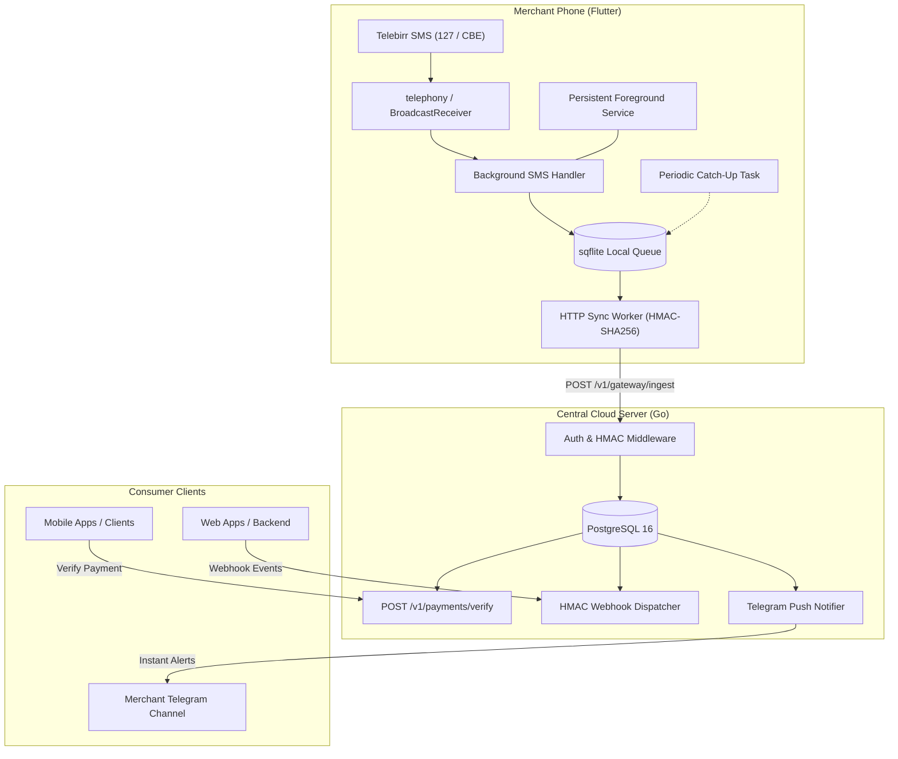

# BirrSync: Autonomous Ethiopian Mobile-Money Verification Engine

[](LICENSE)
[](https://flutter.dev)
[](https://golang.org)
[](https://www.docker.com/)

**BirrSync** is an autonomous, ultra-fast, self-hosted payment bridge for Ethiopia. It bridges standard personal and business **Telebirr** and **Commercial Bank of Ethiopia (CBE)** accounts with your mobile apps, SaaS, and web applications without expensive merchant deposits, third-party cuts, or bureaucratic delays.

---

## Architecture Flow



---

## Key Features

- **Instant SMS Ingestion:** Intercepts Telebirr (127) and CBE Birr transaction messages in background or locked state.
- **Resilient Offline Queue:** SQLite queue inside the Flutter agent holds receipts offline and replays them with backoff once internet connectivity resumes.
- **HMAC-SHA256 Security:** Cryptographically signed agent-to-server traffic with millisecond timestamps and $\pm 120$s replay attack prevention.
- **Atomic Single-Claim Guarantee:** `SELECT ... FOR UPDATE` row locks in PostgreSQL guarantee that a payment receipt can never be double-claimed or exploited.
- **High Concurrency & Ultra-Low Memory:** Go backend uses `< 20MB` RAM and provides sub-millisecond response latency.
- **Instant Telegram Push Alerts:** Get real-time alerts to a private Telegram channel whenever a payment arrives.
- **Periodic Catch-Up Audit:** Scans Android inbox every 15 minutes to guarantee no payment is ever lost, even after device restarts or network drops.

---

## Directory Structure

```
BirrSync/
├── flutter/                      # Flutter Merchant Gateway Mobile App
│   ├── lib/
│   │   ├── background/           # @pragma vm:entry-point SMS handler
│   │   ├── database/             # sqflite Local Queue DB
│   │   ├── parser/               # telebirr_parser.dart (Telebirr & CBE Regex)
│   │   ├── services/             # background_service.dart & sync_service.dart
│   │   ├── workers/              # catchup_worker.dart
│   │   └── ui/                   # Gateway Status & Transaction History UI
│   ├── android/                  # AndroidManifest with foreground service & SMS
│   └── pubspec.yaml
│
├── server/                       # Ultra-Fast Go Backend
│   ├── internal/
│   │   ├── config/               # Environment configuration
│   │   ├── database/             # PostgreSQL connection pool & migrations
│   │   ├── handlers/             # Ingest, Verify, Heartbeat, Health APIs
│   │   ├── middleware/           # HMAC-SHA256 signature verification
│   │   ├── models/               # Data structures
│   │   └── services/             # Telegram notifier & Webhook dispatcher
│   ├── main.go                   # Chi Router & graceful shutdown
│   ├── Dockerfile                # ~15MB multi-stage Alpine build
│   └── docker-compose.yml        # Go Server + PostgreSQL
│
└── docs/
    ├── SETUP_GUIDE.md            # Comprehensive step-by-step setup
    └── OEM_BATTERY_GUIDE.md      # Tecno, Infinix, Samsung & Xiaomi setup
```

---

## Quickstart

### 1. Launch Server with Docker Compose

```bash
cd server
docker compose up -d --build
```

Verify status:
```bash
curl http://localhost:8080/healthz
```

### 2. Verify Payments in Your Client Application

When a customer pays ETB 490.00 via Telebirr:

#### By Transaction Number (Recommended)
```bash
curl -X POST http://localhost:8080/v1/payments/verify \
  -H "Content-Type: application/json" \
  -d '{
    "transaction_id": "DJD1R7KTJJ",
    "expected_amount": 490.00,
    "app_id": "my_mobile_app",
    "user_id": "user_102"
  }'
```

#### By Phone Number (Matches last 4 digits)
```bash
curl -X POST http://localhost:8080/v1/payments/verify \
  -H "Content-Type: application/json" \
  -d '{
    "sender_phone": "0911224819",
    "expected_amount": 490.00,
    "max_age_minutes": 20
  }'
```

---

## Documentation

- [Complete Setup & Deployment Guide](docs/SETUP_GUIDE.md)
- [OEM Battery Optimization Guide](docs/OEM_BATTERY_GUIDE.md)

---

## License

MIT License. BirrSync is open-source software created for independent developers and Ethiopian digital commerce.
